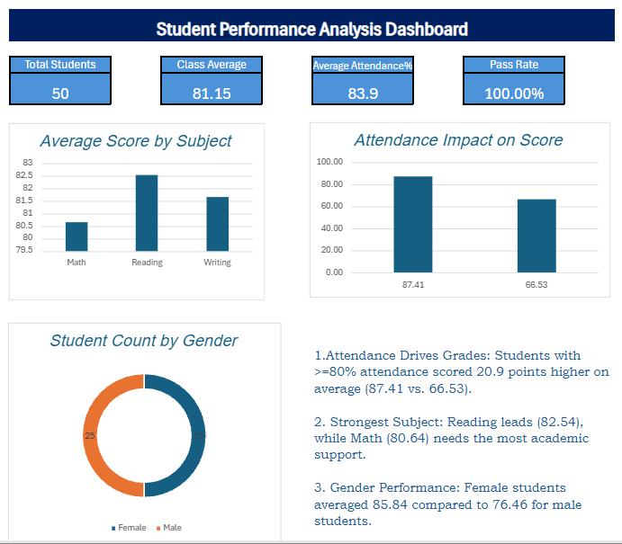
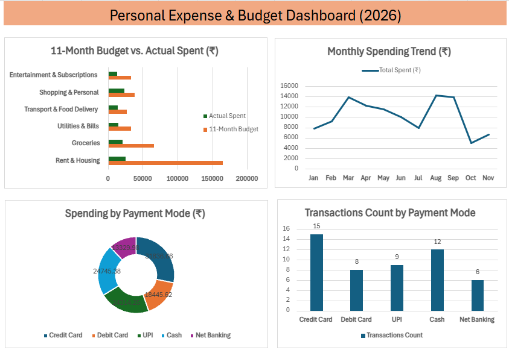
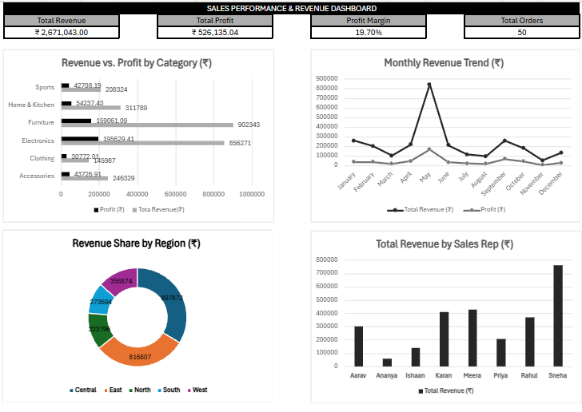

# Excel-Data-Analytics-Projects
A curated portfolio of beginner, intermediate, and advanced Microsoft Excel data analytics dashboards.
---
## 🟢 01. Beginner Projects

### 1. Student Performance Analysis
- **File:** [Student-Performance.xlsx](01_Beginner_Projects/Student-Performance.xlsx)
- **Tools & Formulas:** `SUM`, `AVERAGE`, `IF`, `COUNTA`, `COUNTIF`, `AVERAGEIF`, KPI Cards, Column & Doughnut Charts
- **Key Insights:**
  - **Attendance Drives Grades:** Students with `>=80%` attendance scored **20.9 points higher** on average (`87.41` vs. `66.53`).
  - **Subject Performance:** Reading led all subjects (`82.54`), followed by Writing (`81.66`), while Math (`80.64`) showed the highest opportunity for academic support.
  - **Gender Comparison:** Female students averaged `85.84` compared to `76.46` for male students across 50 students.

### Dashboard Preview:
  

### 2. Personal Expense & Budget Tracker
* **File:** [Expense-Tracker.xlsx](01_Beginner_Projects/Expense-Tracker.xlsx)
* **Tools & Formulas:** `SUM`, `SUMIFS`, `COUNTIFS`, Clustered Bar, Line with Markers, Doughnut & Column Charts
* **Key Insights:**
  * **Budget Utilization:** Tracked 50 transactions totaling **₹1,12,671.89** against an 11-month budget of **₹3,63,000** (**31.0%** utilized, leaving **₹2,50,328.11** remaining).
  * **Monthly Spending Peaks:** Spending peaked in **August (₹14,257.98)** and **March (₹13,841.70)**, while dipping lowest in **October**.
  * **Payment Mode Breakdown:** **Credit Card** led in transaction volume (**15** transactions), followed by **Cash (12)** and **UPI (9)**.

### Dashboard Preview:

### 3. Sales Performance & Revenue Analysis
* **File:** [Sales-Report.xlsx](01_Beginner_Projects/Sales-Report.xlsx)
* **Tools & Formulas:** `SUM`, `SUMIFS`, `COUNTIFS`, `SUMPRODUCT`, Clustered Bar & Column, Line with Markers & Doughnut Charts
* **Key Insights:**
  * **Overall Revenue & Profitability:** Analyzed 50 sales orders generating **₹26,71,043.00** in total revenue and **₹5,26,135.04** in profit (**19.70%** overall profit margin).
  * **Top Performing Categories:** **Furniture** and **Electronics** drove the highest revenue and profit margins across all six product categories.
  * **Regional & Rep Highlights:** **Central (₹8,97,573)** and **East (₹8,16,807)** led regional sales, while **Sneha** ranked as the top-performing sales representative.
  * **Monthly Revenue Peak:** Revenue surged sharply in **May**, marking the highest single-month performance of the year.

**Dashboard Preview:**

